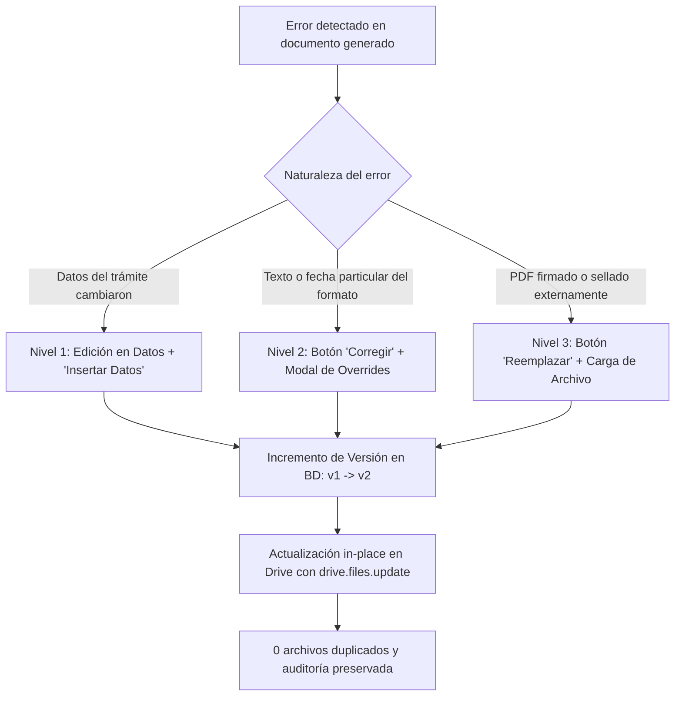

# Registro Integral de Cambios: Módulo de Formatos Oficiales y Gestión de Errores SITUNSA

> **Fecha:** 13 de Octubre de 2026  
> **Sistema:** SITUNSA (Sistema Integrado de Titulación y Segunda Especialidad - FIPS UNSA)  
> **Alcance:** Implementación de formatos oficiales Etapa 01 y 02, motor de carpetas en Google Drive (1 y 2 tesistas), nombres de archivo oficiales y mecanismo de corrección de errores en 3 niveles (Frontend y Backend).

---

## 1. Resumen de la Implementación

Se ha implementado el catálogo completo de plantillas oficiales para los procesos de titulación de la FIPS:
- **Etapa 01 (Plan de Tesis):** 5 formatos oficiales.
- **Etapa 02 (Desarrollo y Sustentación):** 17 formatos oficiales.
- **Estructura en Google Drive:** Carpetas nominativas por expediente con el código y nombres de hasta 2 tesistas, con subcarpetas `01. Plan de Tesis/` y `02. Desarrollo y Sustentacion/`.
- **Fidelidad de Nombres:** Los archivos generados replican de forma exacta los nombres de los formatos entregados, alternando dinámicamente el sufijo entre `01 TESISTA` y `02 TESISTAS`.
- **Flujo de Corrección de Errores:** Sistema de tres niveles para corregir datos generales, modificar etiquetas puntuales (*overrides*) desde un modal interactivo en el frontend, o reemplazar manualmente PDFs escaneados/firmados.

---

## 2. Archivos Creados (Nuevos)

| Archivo | Ruta | Función Principal |
|---------|------|-------------------|
| `modal-modificar-formato.tsx` | `apps/web/src/components/domain/modal-modificar-formato.tsx` | Componente de UI (Modal de Diálogo) que permite al personal administrativo corregir campos específicos de un documento (*overrides*) y regenerarlo in-situ en Google Drive incrementando la versión (Nivel 2 de Corrección). |
| `google-drive.service.ts` | `apps/api/src/infra/storage/google-drive.service.ts` | Servicio de integración con Google Drive API v3 (soporte OAuth 2.0 y Service Account). Gestiona la creación de carpetas nominativas, subcarpetas por etapa, subida y actualización sin duplicados (`files.update`). |
| `sync-drive.worker.ts` | `apps/api/src/infra/jobs/sync-drive.worker.ts` | Worker de procesamiento en segundo plano (asíncrono) para sincronizar y versionar documentos en Google Drive sin degradar el rendimiento de las peticiones HTTP. |
| `generador-caratula.service.ts` | `apps/api/src/modules/documentos/services/generador-caratula.service.ts` | Motor vectorial en `pdf-lib` para crear carátulas oficiales normalizadas con membrete UNSA/FIPS, caja centrada, tesistas en formato Title Case y año. |
| `generador-caratula.service.spec.ts` | `apps/api/src/modules/documentos/services/generador-caratula.service.spec.ts` | Pruebas unitarias automatizadas para la generación de carátulas (formato A4, cabeceras PDF `%PDF-`). |
| `registrar-documento.service.ts` | `apps/api/src/modules/documentos/services/registrar-documento.service.ts` | Servicio centralizado para validar Magic Bytes `%PDF-`, calcular hash criptográfico SHA-256 (cadena de custodia), versionar en base de datos y encolar la sincronización a Drive. |
| `registrar-documento.service.spec.ts` | `apps/api/src/modules/documentos/services/registrar-documento.service.spec.ts` | Pruebas unitarias para el registro de documentos, cálculo de hash e integridad. |
| `obtener-drive-token.ts` | `apps/api/src/scripts/obtener-drive-token.ts` | Script interactivo para vincular cuentas personales de Google Drive mediante OAuth 2.0 y registrar el `refresh_token` en el entorno `.env`. |
| `probar-documentacion.ts` | `apps/api/src/scripts/probar-documentacion.ts` | Script de prueba integral del ciclo de vida documental y sincronización en Google Drive. |
| `0013_misty_timeslip.sql` | `packages/db/drizzle/0013_misty_timeslip.sql` | Migración de base de datos Drizzle ORM que añade columnas `drive_folder_id`, `drive_file_id` y `drive_url` a las tablas de expedientes y documentos generados. |
| `0013_snapshot.json` | `packages/db/drizzle/meta/0013_snapshot.json` | Instantánea del esquema de base de datos para control de versiones de Drizzle. |
| `modulo-almacenamiento-documentacion.md` | `docs/modulo-almacenamiento-documentacion.md` | Documento de arquitectura técnica detallando el almacenamiento híbrido, cadena de custodia y flujos de Drive. |

---

## 3. Archivos Modificados y Cambios Realizados

### Capa de Dominio (`packages/domain`)
1. **`packages/domain/src/documentos/plantillas.ts`**
   - Se incorporó la definición oficial de los 17 formatos de la Etapa 02 (Actas, Anexos, Resoluciones, Oficios).
   - Se crearon las funciones `resolverNombreArchivo(tipo, numTesistas)` y `resolverSubcarpetaEtapa(etapa)`.
   - Implementación estricta de nombres oficiales y alternancia entre `01 TESISTA` y `02 TESISTAS`.
2. **`packages/domain/src/documentos/datos-documento.ts`**
   - Se agregaron al diccionario de datos el 100% de las etiquetas oficiales: tesistas múltiples (`NOMBRES_1`, `NOMBRES_2`, `DNI_1`, `DNI_2`, etc.), terna de jurados (`PRESIDENTE ETAPA 02`, `SECRETARIO ETAPA 02`, `INTEGRANTE`, `SUPLENTE ETAPA 02`), fechas institucionales (`FECHA_CONFORMIDAD`, `FECHA_DICTAMEN`, `FECHA JURADOS`) y números correlativos.
3. **`packages/domain/__tests__/documentos.spec.ts`**
   - Se crearon pruebas unitarias para validar la resolución de nombres, carpetas y sustitución de etiquetas para 1 y 2 tesistas.

### Capa de Contratos (`packages/contracts`)
4. **`packages/contracts/src/documentos.contract.ts`**
   - Se actualizó el esquema Zod `GenerarDocumentosSchema` para aceptar opcionalmente `tipo?: string` y `overrides?: Record<string, string>`, habilitando la regeneración selectiva y corrección puntual.

### Capa de Base de Datos (`packages/db`)
5. **`packages/db/src/schema/documentos.ts`** y **`packages/db/src/schema/expedientes.ts`**
   - Se agregaron los campos `driveFileId`, `driveUrl` y `driveFolderId` para persistir los identificadores de Google Drive.

### Capa de Backend API (`apps/api`)
6. **`apps/api/src/modules/documentos/use-cases/generar-documentos/generar-documentos.use-case.ts`**
   - Soporte para generar por tipo individual o por etapa completa.
   - Aplicación de `overrides` de campos sobre los datos base del expediente.
   - Integración con Google Drive asegurando actualización in-place (`files.update`) sin duplicación de archivos.
   - Firma polimórfica para aceptar fechas u opciones de configuración de manera segura.
7. **`apps/api/src/modules/documentos/documentos.routes.ts`**
   - Conexión de los parámetros `tipo` y `overrides` en la ruta `POST /api/expedientes/:id/documentos/generar`.
   - Modificación del endpoint de descarga para servir los archivos con su nombre oficial (`Content-Disposition: attachment; filename="<nombre_oficial>"`).
8. **`apps/api/src/infra/jobs/colas.ts`** y **`apps/api/src/infra/jobs/workers.ts`**
   - Registro de la cola y worker de sincronización a Google Drive.
9. **`apps/api/package.json`**
   - Instalación de librerías oficiales de Google (`@googleapis/drive`, `google-auth-library`).

### Capa Frontend Web (`apps/web`)
10. **`apps/web/src/api/expedientes.ts`**
    - Se adaptó la mutación `useGenerarDocumentos` para enviar opcionalmente `{ etapa, tipo?, overrides? }`.
11. **`apps/web/src/components/domain/documento-card.tsx`**
    - Se agregó el botón **`CORREGIR`** (con icono de edición) al lado del botón de descarga en cada tarjeta documental del checklist.
    - Se incorporó la prop `onModificar` para abrir el modal de personalización.
12. **`apps/web/src/routes/expedientes.$id.tsx`**
    - Se rediseñó la sección de **Formatos Institucionales Emitidos** en tarjetas organizadas por columnas con título, versión (`v1`, `v2`), indicador de campos pendientes, botón de descarga directa y botón de corrección.
    - Se integró el componente `ModalModificarFormato` para ambas etapas.

---

## 4. Catálogo Oficial de Formatos y Rutas en Drive

| # | Código Interno | Nombre Exacto del Archivo Generado | Subcarpeta en Drive |
|---|----------------|------------------------------------|---------------------|
| 1 | `SOLICITUD_INSCRIPCION` | `ANEXO 17 - 01 TESISTA.pdf` *(o 02 TESISTAS)* | `01. Plan de Tesis/` |
| 2 | `CARATULA_PLAN` | `CARATULA_PLAN DE TESIS.pdf` | `01. Plan de Tesis/` |
| 3 | `DECRETO_APROBACION` | `DECRETO - 01 TESISTA.pdf` *(o 02 TESISTAS)* | `01. Plan de Tesis/` |
| 4 | `OFICIO_CIRCULAR_TERNA` | `OFICIO CIRCULAR- 01 TESISTA.pdf` *(o 02 TESISTAS)* | `01. Plan de Tesis/` |
| 5 | `OBSERVACIONES_PLAN` | `OBSERVACIONES DE PLAN DE TESIS - 01 TESISTA.pdf` *(o 02 TESISTAS)* | `01. Plan de Tesis/` |
| 6 | `ACTA_CONFORMIDAD` | `ACTA DE CONFORMIDAD_TESIS - 01 TESISTA.pdf` *(o 02 TESISTAS)* | `02. Desarrollo y Sustentacion/` |
| 7 | `ACTA_DICTAMEN` | `ACTA DE DICTAMEN_TESIS - 01 TESISTA.pdf` *(o 02 TESISTAS)* | `02. Desarrollo y Sustentacion/` |
| 8 | `ACTA_SUSTENTACION` | `ACTA DE SUSTENTACIÓN - 01 TESISTA.pdf` *(o 02 TESISTAS)* | `02. Desarrollo y Sustentacion/` |
| 9 | `ANEXO_08` | `ANEXO N° 08 INFORME DE CONFORMIDAD DE ASESORAMIENTO - 01 TESISTA.pdf` *(o 02 TESISTAS)* | `02. Desarrollo y Sustentacion/` |
| 10 | `ANEXO_27` | `ANEXO N° 27 SOLICITUD (2) PARA OPTAR TITULO 2DA. ESPECIALIDAD - 01 TESISTA.pdf` *(o 02 TESISTAS)* | `02. Desarrollo y Sustentacion/` |
| 11 | `ANEXO_02_DJ` | `ANEXO N°2 - 01 TESISTA - DECLARACIÓN JURADA.pdf` *(o 02 TESISTAS)* | `02. Desarrollo y Sustentacion/` |
| 12 | `ANEXO_32_VERACIDAD` | `ANEXO N°32 DECLARACIÓN JURADA VERACIDAD DE LA INFORMACIÓN - 02 TESISTA.pdf` *(o 02 TESISTAS)* | `02. Desarrollo y Sustentacion/` |
| 13 | `AUTORIZACION_IMPRESION` | `AUTORIZACIÓN DE IMPRESIÓN_TESIS - 01 TESISTA.pdf` *(o 02 TESISTAS)* | `02. Desarrollo y Sustentacion/` |
| 14 | `AUTORIZACION_PUBLICACION` | `AUTORIZACIÓN DE PUBLICACIÓN_TESIS - 01 TESISTA.pdf` *(o 02 TESISTAS)* | `02. Desarrollo y Sustentacion/` |
| 15 | `ANEXO_01_DJ` | `Anexo-1 - 01 TESISTA.pdf` *(o 02 TESISTAS)* | `02. Desarrollo y Sustentacion/` |
| 16 | `CARATULA_FINAL` | `CARATULA_PLAN DE TESIS FINAL - 01 TESISTA.pdf` *(o 02 TESISTAS)* | `02. Desarrollo y Sustentacion/` |
| 17 | `OBSERVACIONES_TESIS` | `FORMATO - FIPS FORMATO DE OBSERVACIONES DE TESIS - 01 TESISTA.pdf` *(o 02 TESISTAS)* | `02. Desarrollo y Sustentacion/` |
| 18 | `INFORME_SIMILITUD` | `FORMATO INFORME SIMILITUD 00X-UINVESTIGACION-FIPS-2026 (XX_) - 01 TESISTA.pdf` *(o 02 TESISTAS)* | `02. Desarrollo y Sustentacion/` |
| 19 | `INVITACION_PUBLICA` | `INVITACIÓN PÚBLICA_TESIS-01 TESISTA.pdf` *(o 02 TESISTAS)* | `02. Desarrollo y Sustentacion/` |
| 20 | `OFICIO_OTI_SIMILITUD` | `OFICIO N° 322-2026-USE-FIPS A OTI SIMILITUD - 01 TESISTA.pdf` *(o 02 TESISTAS)* | `02. Desarrollo y Sustentacion/` |
| 21 | `OFICIO_UGI_REPOSITORIO` | `OFICIO N° XXX-2026-USE-FIPS A UGI REPOSITORIO - 01 TESISTA.pdf` *(o 02 TESISTAS)* | `02. Desarrollo y Sustentacion/` |
| 22 | `RESOLUCION_DECANAL` | `RESOLUCIÓN DECANAL - 01 TESISTA.pdf` *(o 02 TESISTAS)* | `02. Desarrollo y Sustentacion/` |

---

## 5. Método de Modificación de Archivos (Gestión de Errores)

El sistema opera bajo un **esquema de 3 niveles** para corregir inconsistencias en los documentos emitidos:

1. **Nivel 1 (Regeneración Global de Ficha):**  
   Si se corrigió el título, el asesor o el jurado en la pestaña "Datos", se presiona el botón principal `"INSERTAR DATOS EN DOCUMENTOS"`. El sistema actualiza todos los formatos en bloque.
2. **Nivel 2 (Regeneración con Modificación Específica / Overrides):**  
   Si solo se requiere ajustar un campo específico de un documento (ej. texto de una recomendación o fecha de decreto), el usuario hace clic en el botón **`CORREGIR`** del documento. Se abre el diálogo modal donde puede completar o sustituir cualquier etiqueta y regenerar ese formato específico a una versión incremental (`v2`), actualizándolo en Google Drive en su misma ubicación.
3. **Nivel 3 (Reemplazo Manual Versionado):**  
   Si secretaría o el tesista cuenta con el PDF firmado digitalmente con certificados externos, se utiliza el botón **`REEMPLAZAR`** de la tarjeta documental. El sistema valida el formato, calcula el nuevo hash SHA-256 e incrementa la versión.

---

## 6. Resultados de Verificación y Estado del Sistema

- **Validación E2E en Google Drive:**
  - Expediente con 1 tesista (`SET005`): 7 archivos en Etapa 01 y 17 archivos en Etapa 02 subidos con sufijo `- 01 TESISTA.pdf`.
  - Expediente con 2 tesistas (`SET004`): 7 archivos en Etapa 01 y 17 archivos en Etapa 02 subidos con sufijo `- 02 TESISTAS.pdf`.
  - Prueba de modificación puntual con override: Decreto de Aprobación actualizado in-place a versión `v4` en Google Drive sin generar archivos duplicados.
- **Suite de Pruebas:**
  - 175 tests unitarios y de integración ejecutados exitosamente (`175 passed`, 0 fallos).
- **Servidores en Ejecución:**
  - Web UI: http://localhost:5173
  - API Backend: http://localhost:3001

---

## 7. Transición Arquitectónica: Almacenamiento Primario .DOCX en PostgreSQL (VPS), Identificador Maestro SETxxx y Respaldo Pasivo en Drive

> **Fecha:** 16 de Octubre de 2026  
> **Alcance:** Modificación arquitectónica para almacenar primariamente los documentos en formato Word (.docx) dentro de la base de datos PostgreSQL local en el VPS, dejando a Google Drive exclusivamente como respaldo pasivo asíncrono.

### 7.1. Aspectos Clave de la Solución
1. **Identificador Maestro `SETxxx`:**
   - Inspirado directamente en el piloto Google Script (`DocumentosExpedientes.gs`), cada expediente se articula sobre su código único `SETxxx`. Sin importar que tenga 1 o 2 participantes, la carpeta y todos sus documentos pertenecen a `SETxxx`.
2. **Plantillas Oficiales Saneadas:**
   - Se crearon las plantillas maestras en `packages/domain/plantillas/maestras/1tesista/` y `2tesistas/`.
   - Se eliminaron todos los datos quemados del expediente de prueba `SET064` en `1tesista/`, restituyendo las etiquetas canónicas `<<NOMBRES>>`, `<<DNI>>`, `<<PROGRAMAS>>`, etc.
   - Se preservó el 100% de las imágenes internas (`word/media/image*.png`) con los escudos oficiales de la UNSA, FIPS y sellos decanales.
3. **Motor OpenXML en Node.js (`render-docx.ts`):**
   - Sustituye etiquetas canónicas respetando estilos y tablas.
   - Aplica la regla del piloto: etiquetas vacías se resaltan en amarillo (`<w:highlight w:val="yellow"/>`).
4. **Persistencia Segura en PostgreSQL (Columna `bytea`):**
   - Migración Drizzle `0014_amused_mysterio.sql`: añade `archivo_contenido bytea` y `tamano_bytes integer` a `documentos_generados` y `documentos`.
   - Modificación puramente aditiva sin riesgo ni impacto sobre datos existentes.
5. **Descarga Directa de Alta Velocidad:**
   - El endpoint `GET /api/documentos-generados/:id/descargar` sirve el binario directamente desde PostgreSQL en memoria con encabezados Word (`application/vnd.openxmlformats-officedocument.wordprocessingml.document`).
6. **Respaldo Pasivo en Drive:**
   - La subida a Drive ocurre en segundo plano vía workers asíncronos (`pg-boss` / BullMQ) sin bloquear la descarga del usuario.
7. **Verificación Integral:**
   - 177 tests pasando (`177 passed`).
   - Prueba E2E ejecutada con éxito con `SET005` (1 tesista) y `SET004` (2 tesistas) en Etapas 01 y 02.

