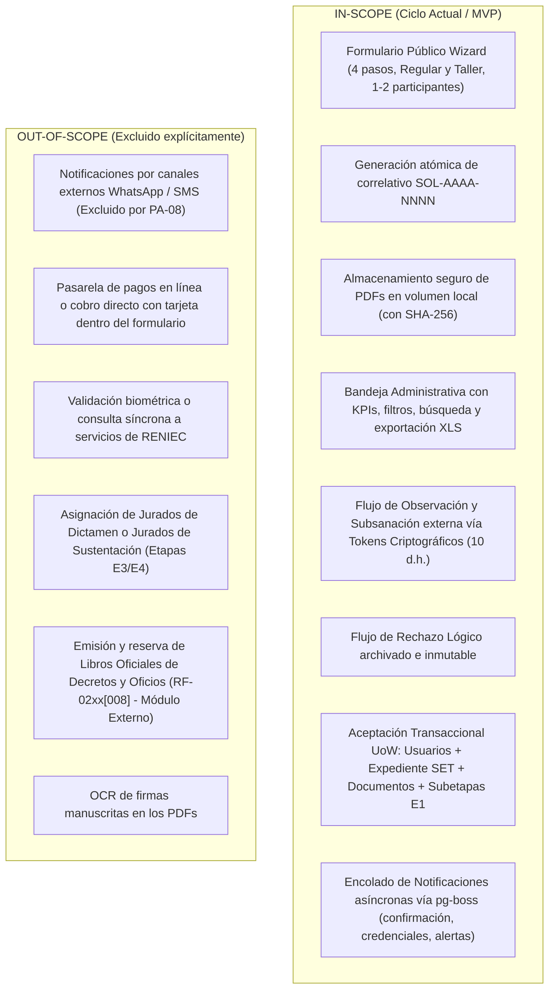
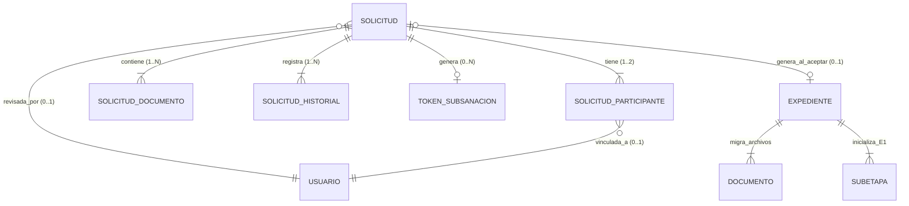
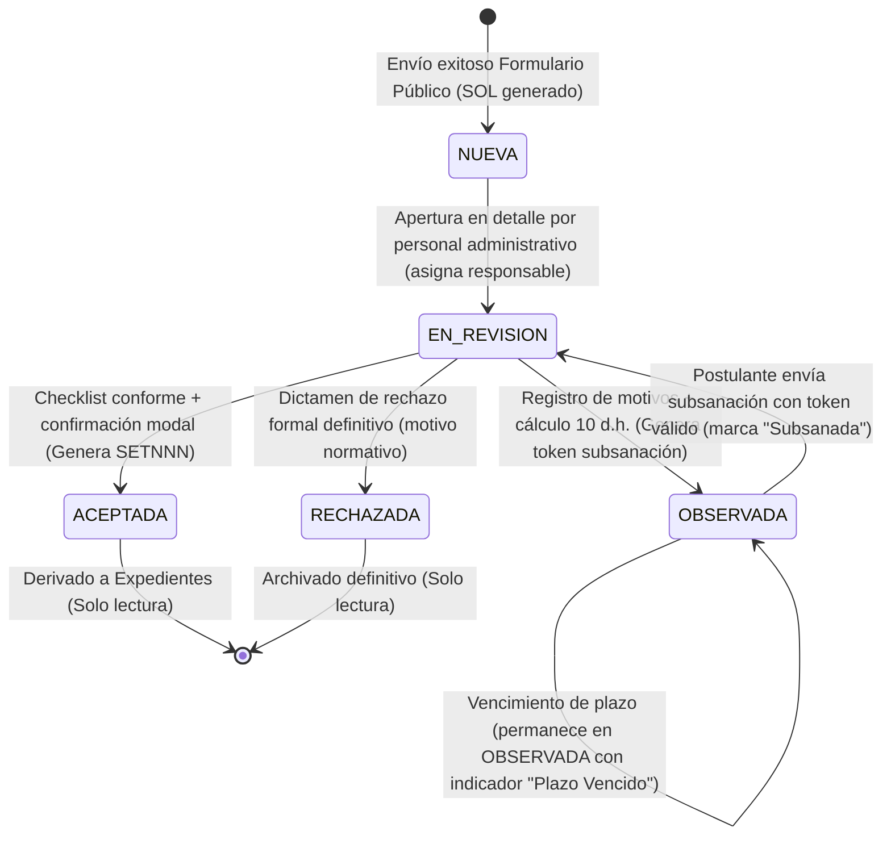

# Especificación Técnica (SDD): Módulo de Obtención de Datos y Gestión de Solicitudes

| Metadato | Valor |
|---|---|
| **Módulo** | Obtención de Datos y Gestión de Solicitudes (Mesa de Partes Virtual a Expediente SET) |
| **Código Documento** | `SPEC-MOD-OBT-001` |
| **Versión** | `01.00.00` |
| **Fecha** | 16/10/2026 |
| **Estado** | Propuesta para Aprobación Técnica (Draft for Review) |
| **Requerimientos Cubiertos** | `RF-02xx[000]` al `RF-02xx[015]` |
| **Mockup Base** | `docs/06-mockups/prototipos_modulo_obtencion_de_datos/prototipo_version2/` (Vistas 0, 1, 2 y 3) |
| **Arquitectura de Referencia** | Monorepo PIS-UNSA (`AGENTS.md`, Fastify 5, React 19, ts-rest, Drizzle ORM, Postgres 16) |

---

## 1. VISIÓN GENERAL Y ALCANCE

### 1.1. Contexto y Problema de Negocio
Actualmente, el inicio del trámite de titulación y la inscripción al Taller de Tesis en la Unidad de Segunda Especialidad e Investigación de la FIPS - UNSA depende de canales informales y fragmentados (recepción manual por correo electrónico institucional/personal o entrega física de documentos en mesa de partes física). 

Esta dinámica introduce graves deficiencias:
1. **Falta de Trazabilidad e Inseguridad Jurídica:** No existe un registro inmutable ni un correlativo unificado que certifique la fecha exacta de recepción, generando reclamos sobre plazos de atención y pérdida de expedientes.
2. **Deficiencias y Errores Recurrentes en Documentación:** Documentos esenciales (Expediente 17/FUD, Carátula Oficial, Plan de Tesis, Vouchers) presentan errores sistemáticos de formato, tildes, discrepancias entre DNI y nombres, o grados académicos del asesor no estandarizados contra SUNEDU.
3. **Ausencia de un Canal Público Guiado para Egresados sin Credencial:** Alumnos egresados de promociones anteriores carecen de correo institucional `@unsa.edu.pe` activo, lo que les impide autenticarse en el portal universitario tradicional para iniciar su titulación.
4. **Carga Administrativa Manual Redundante:** El personal administrativo (Srta. Angela / Sra. Magnolia) debe transcribir manualmente los datos desde correos a hojas de cálculo, crear cuentas de usuario en sistemas aislados y generar expedientes SET a mano, arriesgando inconsistencias y duplicidad de identidades.

### 1.2. Objetivo del Módulo
Diseñar e implementar un componente desacoplado y robusto de **Obtención de Datos y Gestión de Solicitudes** que provea:
1. Un **Portal Público (Mesa de Partes Virtual)** accesible sin credenciales previas, con un formulario wizard de 4 pasos para Vía Regular y Vía Taller de Tesis (1 o 2 participantes).
2. Un **Motor de Admisión y Validación Automatizada** que genere correlativos secuenciales atómicos (`SOL-AAAA-NNNN`), verifique archivos PDF y resguarde la trazabilidad (IP, fecha y agente).
3. Una **Bandeja de Gestión Administrativa** para revisión formal, checklist documentario, subsanación sin cuenta mediante enlaces temporales criptográficos, rechazo fundamentado y aceptación transaccional atómica.
4. Un **Aprovisionamiento Automático de Cuentas y Expediente SET**: En un único commit transaccional (`uow.run`), vincular o crear las cuentas de los tesistas (Google Workspace institucional o credencial local segura), reservar el correlativo SET con candado transaccional (`pg_advisory_xact_lock`), migrar documentos a la carpeta digital e inicializar el seguimiento formal (Etapa 1).

### 1.3. Matriz de Alcance (Scope)



---

## 2. MODELO DE DOMINIO Y ENTIDADES (Framework REASONS)

El diseño del modelo de dominio aplica el framework analítico **REASONS** (Responsibilities, Entities & Attributes, Associations, State & Lifecycle, Operations & Invariants, Non-functional constraints, Security & Scopes) para garantizar pureza e integridad antes de la persistencia.

### 2.1. Responsabilidades del Dominio (Responsibilities)
- **Separación de Ciclos de Vida:** La `Solicitud` es un artefacto transitorio (pre-expediente) en el que los datos pueden ser observados, corregidos o rechazados sin ensuciar el libro maestro de expedientes ni la máquina de estados macro.
- **Inmutabilidad de la Vía:** Una solicitud nace como `REGULAR` o `TALLER`; esta clasificación determina qué reglas de validación y qué documentos se exigen, y se transfiere de forma inmutable al `Expediente`.
- **Identidad de Participantes:** Garantizar que los alumnos registrados mantengan unicidad por DNI/CUI. No se duplican personas en `usuarios`; se reutilizan o se crean de manera atómica con rol `TESISTA`.

### 2.2. Entidades y Atributos Esenciales (Entities & Attributes)



#### A. Entidad Agregada: `Solicitud`
Representa el trámite formal de postulación ingresado por la mesa de partes virtual.
- `id`: `UUID` (PK, autogenerado).
- `codigo`: `VARCHAR(32)` (Unique, ej: `SOL-2026-0001`).
- `via`: `ENUM('REGULAR', 'TALLER')` (Inmutable).
- `modalidad`: `ENUM('TESIS', 'TRABAJO_ACADEMICO', 'ARTICULO')`.
- `programa`: `VARCHAR(160)` (Debe coincidir con catálogo oficial de 13 programas FIPS).
- `titulo`: `TEXT` (Título preliminar normalizado a tipo oración).
- `anioEgreso`: `INTEGER` (Año de egreso universitario).
- `cantidadTesistas`: `SMALLINT` (`1` o `2`).
- `estado`: `ENUM('NUEVA', 'EN_REVISION', 'OBSERVADA', 'ACEPTADA', 'RECHAZADA')` (Default: `NUEVA`). Nota: Al vencer el plazo de 10 d.h. permanece en `OBSERVADA` con indicador visual de vencimiento.
- `responsableAsignadoId`: `UUID` (FK `usuarios.id`, nullable).
- `fechaLimiteSubsanacion`: `DATE` (Nullable, calculada sumando 10 días hábiles en estado `OBSERVADA`).
- `motivoObservacion`: `TEXT` (Nullable, plantilla o texto explicativo).
- `motivoRechazo`: `TEXT` (Nullable, justificación formal normativa).
- `expedienteId`: `UUID` (FK `expedientes.id`, nullable; se vincula al ser `ACEPTADA`).
- `tallerGrupoId`: `UUID` (FK `grupos_taller.id`, nullable; requerido en vía `TALLER` al aceptar).
- `ipOrigen`: `VARCHAR(45)` (Auditoría de envío público).
- `userAgent`: `TEXT` (Cabecera del cliente remitente).
- `createdAt`: `TIMESTAMP WITH TIME ZONE` (Default: `NOW()`).
- `updatedAt`: `TIMESTAMP WITH TIME ZONE` (Default: `NOW()`).

#### B. Entidad: `SolicitudParticipante`
Datos de los solicitantes (1 titular, opcionalmente 1 co-tesista).
- `id`: `UUID` (PK).
- `solicitudId`: `UUID` (FK `solicitudes.id` ON DELETE CASCADE).
- `orden`: `SMALLINT` (`1` = Titular, `2` = Co-tesista).
- `nombres`: `VARCHAR(160)` (Exactos según DNI).
- `apellidos`: `VARCHAR(160)` (Exactos según DNI).
- `dni`: `VARCHAR(8)` (8 dígitos numéricos exactos).
- `cui`: `VARCHAR(16)` (Código Universitario de alumno).
- `email`: `VARCHAR(255)` (Personal o institucional; normalizado a minúsculas).
- `telefono`: `VARCHAR(20)`.
- `nacionalidad`: `VARCHAR(64)` (Por defecto "Peruana").
- `ciudad`: `VARCHAR(64)` (Vía Regular).
- `direccion`: `TEXT`.
- `departamento`: `VARCHAR(64)` (Vía Taller).
- `provincia`: `VARCHAR(64)` (Vía Taller).
- `distrito`: `VARCHAR(64)` (Vía Taller).
- `usuarioId`: `UUID` (FK `usuarios.id`, nullable; si ya existe, se sincronizan/actualizan teléfono y dirección al aceptar).
- *Restricción de Integridad:* `UNIQUE(solicitudId, orden)`, `UNIQUE(solicitudId, dni)`.

#### C. Entidad: `SolicitudDocumento`
Archivos digitalizados adjuntados en la postulación o en la subsanación.
- `id`: `UUID` (PK).
- `solicitudId`: `UUID` (FK `solicitudes.id` ON DELETE CASCADE).
- `tipo`: `VARCHAR(64)` (Ej: `EXPEDIENTE_17`, `CARATULA`, `PLAN_TESIS`, `FOTO`, `DNI_DOC`, `NO_ADEUDO`, `CV`, `CARTA_COMPROMISO`, `VOUCHER`).
- `participanteOrden`: `SMALLINT` (Nullable: `NULL` si el archivo es compartido; `1` o `2` si es individual).
- `ruta`: `TEXT` (Ruta física absoluta dentro de `DOCS_VOLUME_PATH/solicitudes/SOL-AAAA-NNNN/`).
- `nombreOriginal`: `VARCHAR(255)`.
- `mimeType`: `VARCHAR(100)` (Restringido a `application/pdf`, o `image/jpeg` para fotos).
- `pesoBytes`: `INTEGER` (Máximo 20 MB por archivo).
- `sha256`: `VARCHAR(64)` (Digest criptográfico inmutable para verificación de integridad).
- `version`: `INTEGER` (Default `1`; se incrementa si se subsana el archivo).
- `estadoConformidad`: `ENUM('PENDIENTE', 'CONFORME', 'OBSERVADO')` (Default `PENDIENTE`).
- `marcadoPurgaAt`: `TIMESTAMP WITH TIME ZONE` (Nullable; previsto para política futura de purga de archivos en solicitudes desestimadas).
- `createdAt`: `TIMESTAMP WITH TIME ZONE` (Default `NOW()`).

#### D. Entidad: `SolicitudHistorial`
Trazabilidad append-only de cada evento administrativo ocurrido sobre la solicitud.
- `id`: `UUID` (PK).
- `solicitudId`: `UUID` (FK `solicitudes.id`).
- `accion`: `VARCHAR(40)` (`CREADA`, `ASIGNADA_REVISION`, `DATOS_CORREGIDOS`, `OBSERVADA`, `SUBSANADA`, `RECHAZADA`, `ACEPTADA`).
- `actorId`: `UUID` (FK `usuarios.id`, nullable en acciones públicas del tesista).
- `actorDni`: `VARCHAR(32)` (DNI o "postulante_publico" o "sistema").
- `ip`: `VARCHAR(45)`.
- `detalle`: `TEXT`.
- `metadata`: `JSONB` (Estructura tipada: `{ campoModificado, valorAnterior, valorNuevo }` o `{ motivos: string[] }`).
- `createdAt`: `TIMESTAMP WITH TIME ZONE` (Default `NOW()`).

#### E. Entidad: `TokenSubsanacion`
Enlace criptográfico de acceso temporal para levantar observaciones sin requerir login.
- `id`: `UUID` (PK).
- `solicitudId`: `UUID` (FK `solicitudes.id`).
- `hash`: `VARCHAR(64)` (SHA-256 del token plano entregado por correo).
- `expiraAt`: `TIMESTAMP WITH TIME ZONE` (Fecha límite de subsanación: 10 d.h.).
- `usadoAt`: `TIMESTAMP WITH TIME ZONE` (Nullable; nulo hasta que se remita la subsanación).
- `createdAt`: `TIMESTAMP WITH TIME ZONE` (Default `NOW()`).

---

### 2.3. Máquina de Estados de la Solicitud (FSM)



| Estado Origen | Evento / Acción | Estado Destino | Guardas / Reglas de Negocio | Efectos Colaterales (Side Effects) |
|---|---|---|---|---|
| `[*]` | `REGISTRAR_SOLICITUD` | `NUEVA` | Captcha válido, DJ marcada, DNI válidos no duplicados en el form. | Genera `SOL-AAAA-NNNN`. Encola correo de acuse de recibo. |
| `NUEVA` | `ABRIR_DETALLE` | `EN_REVISION` | Usuario administrativo autenticado. | Registra `responsableAsignadoId`. Registra historial. |
| `EN_REVISION` | `OBSERVAR_SOLICITUD` | `OBSERVADA` | Al menos un motivo seleccionado o texto $\ge 10$ caracteres. | Calcula fecha límite (10 d.h. hábiles UNSA). Emite `TokenSubsanacion`. Encola correo con URL segura. |
| `OBSERVADA` | `ENVIAR_SUBSANACION` | `EN_REVISION` | Token válido, no expirado y no usado. Solo edita campos/archivos observados. | Incrementa versiones de archivos. Quema el token (`usadoAt = NOW()`). Encola correo de aviso al responsable. |
| `OBSERVADA` | `VENCIMIENTO_PLAZO` | `OBSERVADA` | `NOW() > fechaLimiteSubsanacion`. Permanece en `OBSERVADA`. | Muestra badge/alerta visual "Plazo Vencido" en la bandeja. El administrativo puede prorrogar o rechazar manualmente. |
| `EN_REVISION` | `RECHAZAR_SOLICITUD` | `RECHAZADA` | Motivo de rechazo $\ge 10$ caracteres. Confirmación explícita. | Bloquea la solicitud como inmutable. Encola correo de rechazo con fundamento. |
| `EN_REVISION` | `ACEPTAR_SOLICITUD` | `ACEPTADA` | Checklist documental conforme. Cuentas resueltas. Si taller: grupo/asesor asignado. | Transacción UoW: crea o actualiza cuentas en `usuarios`, asigna `SETNNN`, migra docs a `documentos`, inicializa E1. |

---

### 2.4. Operaciones, Invariantes y Reglas de Negocio (Operations & Invariants)

- **RN-SOL-01 (Concurrencia de Correlativos):** La generación de `SOL-AAAA-NNNN` y `SETNNN` debe ser atómica. Se prohíbe calcular el máximo correlativo mediante lecturas sucias en paralelo. Debe asegurarse mediante un cerrojo a nivel de transacción de PostgreSQL:
  ```sql
  SELECT pg_advisory_xact_lock(hashtext('solicitudes:codigo:' || to_char(NOW(), 'YYYY')));
  ```
- **RN-SOL-02 (Inmutabilidad de la Vía de Ingreso):** Una vez que la solicitud se remite, el campo `via` no puede modificarse. Si un postulante postuló por Taller cuando le correspondía Vía Regular, la solicitud debe ser rechazada u observada con indicación de que remita una nueva solicitud.
- **RN-SOL-03 (Unicidad y Regla de Parejas):** En solicitudes de 2 participantes, `dni_p1 != dni_p2` y `email_p1 != email_p2`. Si un DNI ya posee un expediente abierto en la misma modalidad, la bandeja alertará con semáforo rojo al administrativo antes de aceptar.
- **RN-SOL-04 (Protección de Datos en Mesa de Partes Pública):** Para evitar vectores de enumeración o fuga de información de alumnos, el formulario público jamás confirmará si un DNI ya tiene trámite abierto o qué correo tiene asignado. Cualquier duplicidad detectada se advertirá en la bandeja interna administrativa (`RF-02xx[013]`).
- **RN-SOL-05 (Cálculo Riguroso de Días Hábiles):** El plazo de 10 días para subsanaciones computa exclusivamente días hábiles (excluyendo sábados, domingos y feriados nacionales/regionales de Arequipa), importando la función de kernel puro `@pis/domain/dist/expediente/dias-habiles.js`.
- **RN-SOL-06 (Auditoría de Modificaciones Menores):** Si el administrativo corrige una errata en el nombre o título antes de aprobar, el sistema no sobrescribe silenciosamente: genera un registro inmutable en `solicitud_historial` guardando el DNI del administrativo, IP, timestamp, valor anterior y nuevo valor.

---

## 3. REQUISITOS TÉCNICOS Y ARQUITECTURA

### 3.1. Tech Stack Estricto y Paridad
En estricto cumplimiento de `AGENTS.md`, no se añaden dependencias externas como Redis, MinIO o servicios de colas en la nube:
- **Runtime:** Node.js 22 LTS / TypeScript 5.6 en modo estricto (`exactOptionalPropertyTypes: true`, `noImplicitAny: true`).
- **Backend Framework:** Fastify standalone + ts-rest para contratos fuertemente tipados. Rutas multipart nativas Fastify para subida de archivos (debido a limitaciones conocidas de ts-rest multipart).
- **Frontend SPA:** Vite + React 19 SPA con Tailwind CSS 4 (`@theme`), componentes atómicos CVA + Radix UI en `apps/web/src/components/ui/`.
- **Persistencia & ORM:** PostgreSQL 16 con Drizzle ORM. Toda mutación estructural pasa por migraciones Drizzle compiladas (`db:generate` + `db:migrate`).
- **Procesamiento de Tareas de Fondo (Jobs):** `pg-boss` respaldado en PostgreSQL para el encolado confiable de correos (nodemailer con Mailpit en dev, SMTP en prod).
- **Gestión de Archivos:** Almacenamiento en volumen de disco local (`DOCS_VOLUME_PATH`). Entrega eficiente de archivos en producción mediante cabecera `X-Accel-Redirect` gestionada por Nginx (stream controlado en desarrollo).

---

### 3.2. Estructura de Archivos e Impacto en el Monorepo

```
situnsa/
├── packages/
│   ├── contracts/
│   │   └── src/
│   │       ├── solicitudes.contract.ts          # [NEW] Contratos ts-rest + Esquemas Zod
│   │       ├── enums.ts                         # [MODIFY] Agregar enums EstadoSolicitud, ViaIngreso
│   │       └── index.ts                         # [MODIFY] Export de solicitudes.contract
│   ├── db/
│   │   ├── src/schema/
│   │   │   ├── solicitudes.ts                   # [NEW] Tablas: solicitudes, participantes, docs, historial, tokens
│   │   │   ├── enums.ts                         # [MODIFY] pgEnum estado_solicitud, via_ingreso
│   │   │   └── index.ts                         # [MODIFY] Export schema solicitudes
│   │   └── drizzle/                             # Migraciones SQL generadas (000X_solicitudes.sql)
│   └── domain/
│       └── src/
│           ├── solicitud/
│           │   ├── solicitud.aggregate.ts       # [NEW] Reglas puras de dominio y FSM
│           │   ├── plazos-solicitud.ts          # [NEW] Lógica de 10 días hábiles
│           │   └── validaciones.ts              # [NEW] Reglas de 1 o 2 participantes y nombres
│           └── index.ts                         # [MODIFY] Export público del kernel puro
├── apps/
│   ├── api/
│   │   └── src/
│   │       ├── modules/
│   │       │   └── solicitudes/
│   │       │       ├── solicitudes-publicas.routes.ts   # [NEW] Rutas nativas Fastify (Multipart y descargas)
│   │       │       ├── solicitudes-admin.routes.ts      # [NEW] Router ts-rest para bandeja y detalle
│   │       │       ├── solicitudes.repository.ts        # [NEW] Consultas Drizzle y filtros de bandeja
│   │       │       └── use-cases/
│   │       │           ├── crear-solicitud/             # [NEW] Wizard público y guardado de PDFs
│   │       │           ├── listar-solicitudes/          # [NEW] Bandeja paginada con KPIs
│   │       │           ├── obtener-solicitud/           # [NEW] Detalle completo y checklist
│   │       │           ├── observar-solicitud/          # [NEW] Emisión token y notificación
│   │       │           ├── subsanar-solicitud/          # [NEW] Reemplazo de archivos versionados
│   │       │           ├── rechazar-solicitud/          # [NEW] Cierre lógico fundamentado
│   │       │           ├── aceptar-solicitud/           # [NEW] UoW atómico: Creación Expediente SET + Cuentas
│   │       │           └── exportar-solicitudes-xls/    # [NEW] Generación XLSX con infraestructura nativa
│   │       └── server.ts                                # [MODIFY] Registro de rutas del módulo
│   └── web/
│       └── src/
│           ├── api/
│           │   └── solicitudes.ts                       # [NEW] Cliente fetch tipado de solicitudes
│           ├── routes/
│           │   ├── mesa-de-partes.tsx                   # [NEW] Wizard público de 4 pasos (Mockup Vista 0)
│           │   ├── subsanar.$token.tsx                  # [NEW] Portal público de subsanación de observaciones
│           │   ├── solicitudes.tsx                      # [NEW] Bandeja Administrativa (Mockup Vista 1)
│           │   └── solicitudes.$id.tsx                  # [NEW] Detalle, visor PDF y modales (Mockups Vistas 2 y 3)
│           └── components/
│               └── domain/solicitudes/
│                   ├── modal-aceptar-expediente.tsx     # [NEW] Modal con aprovisionamiento de cuentas
│                   ├── modal-observar-solicitud.tsx     # [NEW] Modal con motivos y plazos
│                   ├── modal-rechazar-solicitud.tsx     # [NEW] Modal de confirmación de desestimación
│                   └── checklist-documentario.tsx       # [NEW] Lista interactiva de verificación de archivos
```

---

## 4. CONTRATOS DE COMPORTAMIENTO Y LÓGICA DE NEGOCIO

### 4.1. Especificación de Endpoints HTTP

#### A. Rutas Nativas Fastify (Archivos y Multipart)
1. `POST /api/v1/public/solicitudes`
   - **Propósito:** Recepción de datos del formulario wizard y carga física de documentos adjuntos.
   - **Autenticación:** Pública (Abierta). Protegida con honeypot y rate limiting por IP (máx. 5 envíos por IP/hora).
   - **Consumes:** `multipart/form-data`.
   - **Payload:** Campos serializados en JSON en el campo de texto `payload`, más los archivos binarios identificados por clave (`archivo_expediente17`, `archivo_caratula`, `archivo_plan_tesis`, `archivo_foto_p1`, etc.).
   - **Respuesta 201 (Created):**
     ```json
     {
       "ok": true,
       "datos": {
         "codigo": "SOL-2026-0012",
         "mensaje": "Solicitud registrada con éxito. Se ha enviado un correo con el código de seguimiento."
       }
     }
     ```
2. `GET /api/v1/solicitudes/:id/documentos/:documentoId/descargar`
   - **Propósito:** Descarga o visualización protegida de un PDF individual.
   - **Autenticación:** Requerida (`ADMIN_FIPS`, `SECRETARIA`, `RESPONSABLE_TITULACION`, `VALIDADOR_TALLER`).
   - **Mecanismo:** Fastify valida permisos y emite cabecera `X-Accel-Redirect` (producción) apuntando a `/protected-files/solicitudes/...`.
3. `GET /api/v1/solicitudes/:id/descarga-masiva-zip`
   - **Propósito:** Descargar todos los archivos de la solicitud comprimidos en un único ZIP.
   - **Autenticación:** Requerida (Roles administrativos autorizados).

---

#### B. Rutas ts-rest (Gestión y Dictamen)

```typescript
// packages/contracts/src/solicitudes.contract.ts
import { initContract } from "@ts-rest/core";
import { z } from "zod";
import { ErrorEnvelopeSchema, PaginacionMetaSchema } from "./api-conventions.js";

const c = initContract();

export const SolicitudResumenSchema = z.object({
  id: z.string().uuid(),
  codigo: z.string(),
  fechaHora: z.string(),
  via: z.enum(["REGULAR", "TALLER"]),
  modalidad: z.enum(["TESIS", "TRABAJO_ACADEMICO", "ARTICULO"]),
  programa: z.string(),
  tesistaTitular: z.object({
    nombresCompletos: z.string(),
    dni: z.string(),
  }),
  coTesista: z.object({
    nombresCompletos: z.string(),
    dni: z.string(),
  }).nullable(),
  totalDocumentos: z.number().int(),
  documentosConformes: z.number().int(),
  estado: z.enum(["NUEVA", "EN_REVISION", "OBSERVADA", "ACEPTADA", "RECHAZADA", "VENCIDA"]),
  expedienteCodigo: z.string().nullable(),
});

export const KpisSolicitudesSchema = z.object({
  nuevas: z.number().int(),
  enRevision: z.number().int(),
  expedientesCreados: z.number().int(),
  observadas: z.number().int(),
  tiempoPromedioEsperaHoras: z.number(),
});

export const solicitudesContract = c.router({
  // Bandeja Administrativa (Mockup Vista 1)
  listar: {
    method: "GET",
    path: "/api/v1/solicitudes",
    query: z.object({
      page: z.coerce.number().default(1),
      limit: z.coerce.number().default(15),
      via: z.enum(["REGULAR", "TALLER"]).optional(),
      estado: z.enum(["NUEVA", "EN_REVISION", "OBSERVADA", "ACEPTADA", "RECHAZADA", "VENCIDA"]).optional(),
      programa: z.string().optional(),
      q: z.string().optional(), // Búsqueda por DNI, CUI, Nombres o SOL
      desde: z.string().optional(),
      hasta: z.string().optional(),
    }),
    responses: {
      200: z.object({
        items: z.array(SolicitudResumenSchema),
        meta: PaginacionMetaSchema,
        kpis: KpisSolicitudesSchema,
      }),
      401: ErrorEnvelopeSchema,
      403: ErrorEnvelopeSchema,
    },
  },

  // Detalle Completo de Solicitud (Mockup Vista 2)
  obtenerPorId: {
    method: "GET",
    path: "/api/v1/solicitudes/:id",
    responses: {
      200: z.object({
        solicitud: z.object({
          id: z.string().uuid(),
          codigo: z.string(),
          via: z.enum(["REGULAR", "TALLER"]),
          modalidad: z.string(),
          programa: z.string(),
          titulo: z.string(),
          estado: z.string(),
          fechaRecepcion: z.string(),
          responsableAsignado: z.string().nullable(),
          participantes: z.array(z.object({
            orden: z.number(),
            nombres: z.string(),
            apellidos: z.string(),
            dni: z.string(),
            cui: z.string().nullable(),
            email: z.string(),
            telefono: z.string().nullable(),
            direccion: z.string().nullable(),
            ciudadODistrito: z.string().nullable(),
            esCuentaInstitucional: z.boolean(),
            poseeCuentaPrevia: z.boolean(),
          })),
          documentos: z.array(z.object({
            id: z.string().uuid(),
            tipo: z.string(),
            nombreArchivo: z.string(),
            tamanoBytes: z.number(),
            version: z.number(),
            estadoConformidad: z.enum(["PENDIENTE", "CONFORME", "OBSERVADO"]),
            sha256: z.string(),
          })),
          trazabilidad: z.array(z.object({
            id: z.string().uuid(),
            accion: z.string(),
            actor: z.string(),
            fechaHora: z.string(),
            ip: z.string().nullable(),
            detalle: z.string(),
          })),
        }),
      }),
      404: ErrorEnvelopeSchema,
    },
  },

  // Acción: Observar Solicitud
  observar: {
    method: "POST",
    path: "/api/v1/solicitudes/:id/observar",
    body: z.object({
      motivosPredefinidos: z.array(z.string()).min(1),
      detalleObservacion: z.string().min(5).max(2000),
      diasHabilesSubsanacion: z.number().int().min(1).max(30).default(10),
    }),
    responses: {
      200: z.object({ ok: z.literal(true), mensaje: z.string() }),
      400: ErrorEnvelopeSchema,
      409: ErrorEnvelopeSchema,
    },
  },

  // Acción: Rechazar Solicitud Definitivamente
  rechazar: {
    method: "POST",
    path: "/api/v1/solicitudes/:id/rechazar",
    body: z.object({
      fundamentoReglamentario: z.string().min(10).max(2000),
    }),
    responses: {
      200: z.object({ ok: z.literal(true), mensaje: z.string() }),
      400: ErrorEnvelopeSchema,
      409: ErrorEnvelopeSchema,
    },
  },

  // Acción: Aceptar y Generar Expediente SET (Mockup Vista 3)
  aceptar: {
    method: "POST",
    path: "/api/v1/solicitudes/:id/aceptar",
    body: z.object({
      codigoSetConfirmado: z.string().regex(/^SET\d{3,}$/, "Formato debe ser SETNNN"),
      tituloConfirmado: z.string().min(10),
      programaConfirmado: z.string(),
      crearCuentasUsuarios: z.boolean().default(true),
      participantesConfig: z.array(z.object({
        orden: z.number(),
        dni: z.string().length(8),
        usuarioAsignado: z.string().min(3),
        claveTemporalGenerada: z.string().min(8),
        enviarCredencialesCorreo: z.boolean().default(true),
      })),
      tallerGrupoId: z.string().uuid().optional(), // Obligatorio si via == 'TALLER'
      asesorId: z.string().uuid().optional(),
    }),
    responses: {
      200: z.object({
        ok: z.literal(true),
        expedienteId: z.string().uuid(),
        codigoSet: z.string(),
      }),
      400: ErrorEnvelopeSchema,
      409: ErrorEnvelopeSchema,
    },
  },

  // Portal Público: Subsanar Solicitud mediante Token
  subsanarConToken: {
    method: "POST",
    path: "/api/v1/public/subsanar/:token",
    body: z.object({
      correccionesDatos: z.record(z.string(), z.string()).optional(),
      archivosSubsanadosIds: z.array(z.string().uuid()).optional(),
    }),
    responses: {
      200: z.object({ ok: z.literal(true), mensaje: z.string() }),
      400: ErrorEnvelopeSchema,
      404: ErrorEnvelopeSchema,
    },
  },
});
```

---

### 4.2. Lógica del Caso de Uso: `AceptarSolicitudUseCase`
Es la transacción nuclear del módulo. Orquesta la materialización de la solicitud al núcleo del sistema.

```typescript
// apps/api/src/modules/solicitudes/use-cases/aceptar-solicitud/aceptar-solicitud.use-case.ts
export class AceptarSolicitudUseCase {
  constructor(
    private readonly uow: UnitOfWork,
    private readonly passHasher: PasswordHasher,
  ) {}

  async execute(input: AceptarSolicitudInput, actor: Actor): Promise<Result<ExpedienteCreado, DomainError>> {
    return await this.uow.run(async (tx) => {
      // 1. Obtener la solicitud con lock FOR UPDATE
      const solicitud = await tx.select().from(solicitudes)
        .where(eq(solicitudes.id, input.solicitudId))
        .for("update")
        .limit(1);

      if (!solicitud[0]) return fail(new DomainError("NO_ENCONTRADO", "Solicitud no encontrada"));
      if (solicitud[0].estado !== "EN_REVISION") {
        return fail(new DomainError("TRANSICION_INVALIDA", `No se puede aceptar una solicitud en estado ${solicitud[0].estado}`));
      }

      // 2. Validación de Vía Taller (RF-02xx[012])
      if (solicitud[0].via === "TALLER" && !input.tallerGrupoId) {
        return fail(new DomainError("VALIDACION_FALLIDA", "La vía Taller exige la asignación previa de un grupo activo"));
      }

      // 3. Resolver Cuentas de Usuarios (RF-02xx[006])
      const participantes = await tx.select().from(solicitudParticipantes)
        .where(eq(solicitudParticipantes.solicitudId, solicitud[0].id))
        .orderBy(solicitudParticipantes.orden);

      const usuariosIds: string[] = [];
      const credencialesAEnviar: Array<{ email: string; user: string; pass: string }> = [];

      for (const part of participantes) {
        let userId: string;
        const config = input.participantesConfig.find((c) => c.orden === part.orden);

        // Buscar si ya existe usuario por DNI
        const existente = await tx.select().from(usuarios).where(eq(usuarios.dni, part.dni)).limit(1);
        if (existente[0]) {
          userId = existente[0].id;
          // RF-02xx[006]/RF-02xx[013]: Sincronizar datos de contacto si cambiaron
          await tx.update(usuarios).set({
            telefono: part.telefono ?? existente[0].telefono,
            direccion: part.direccion ?? existente[0].direccion,
            ciudad: (part.ciudad ?? part.distrito) ?? existente[0].ciudad,
          }).where(eq(usuarios.id, userId));
        } else {
          // Crear usuario con clave temporal de un solo uso
          const rawPass = config?.claveTemporalGenerada ?? crypto.randomBytes(6).toString("hex") + "A1!";
          const hash = await this.passHasher.hash(rawPass);

          const insertedUser = await tx.insert(usuarios).values({
            dni: part.dni,
            cui: part.cui,
            nombres: part.nombres,
            apellidos: part.apellidos,
            email: part.email,
            telefono: part.telefono,
            direccion: part.direccion,
            ciudad: part.ciudad ?? part.distrito,
            rol: "TESISTA",
            passwordHash: hash,
            activo: true,
          }).returning({ id: usuarios.id });

          userId = insertedUser[0]!.id;

          if (config?.enviarCredencialesCorreo) {
            credencialesAEnviar.push({ email: part.email, user: config.usuarioAsignado, pass: rawPass });
          }
        }
        usuariosIds.push(userId);
      }

      // 4. Adquirir candado transaccional para el correlativo SET (RF-02xx[003])
      await tx.execute(sql`SELECT pg_advisory_xact_lock(hashtext('expedientes:codigo'))`);
      const codigoSet = input.codigoSetConfirmado;

      // 5. Insertar Expediente Maestro
      const nuevoExp = await tx.insert(expedientes).values({
        codigo: codigoSet,
        estado: "REGISTRADO",
        modalidad: solicitud[0].modalidad,
        programa: input.programaConfirmado,
        titulo: input.tituloConfirmado,
        participante1Id: usuariosIds[0]!,
        participante2Id: usuariosIds[1] ?? null,
        asesorId: input.asesorId ?? null,
        metadata: { viaOrigen: solicitud[0].via, solicitudId: solicitud[0].id },
      }).returning({ id: expedientes.id });

      const expedienteId = nuevoExp[0]!.id;

      // 6. Migrar Documentos de la Solicitud a la Carpeta Digital del Expediente
      const docsSolicitud = await tx.select().from(solicitudDocumentos)
        .where(eq(solicitudDocumentos.solicitudId, solicitud[0].id));

      for (const d of docsSolicitud) {
        await tx.insert(documentos).values({
          expedienteId,
          tipo: d.tipo,
          etapa: "E1",
          ruta: d.ruta,
          version: d.version,
          sha256: d.sha256,
          estado: "APROBADO",
        });
      }

      // 7. Inicializar Subetapas de la Etapa 1 en el Expediente
      const subetapasE1 = CATALOGO_SUBETAPAS_E1; // E1.1 a E1.6 según FLUJO_TITULACION
      for (const sub of subetapasE1) {
        await tx.insert(subetapas).values({
          expedienteId,
          etapa: 1,
          orden: sub.orden,
          nombre: sub.nombre,
          plazo: sub.plazo,
          clave: sub.clave,
          estado: sub.orden === 1 ? "EN_CURSO" : "NO_INICIADO",
          responsable: actor.dni,
          inicio: sub.orden === 1 ? new Date() : null,
        });
      }

      // 8. Si es Vía Taller: Asignar a grupo y cronograma
      if (solicitud[0].via === "TALLER" && input.tallerGrupoId) {
        for (const uId of usuariosIds) {
          await tx.insert(grupoMiembros).values({
            grupoId: input.tallerGrupoId,
            usuarioId: uId,
          });
        }
      }

      // 9. Actualizar Solicitud a ACEPTADA y vincular FK
      await tx.update(solicitudes).set({
        estado: "ACEPTADA",
        expedienteId,
        updatedAt: new Date(),
      }).where(eq(solicitudes.id, solicitud[0].id));

      // 10. Trazabilidad e Historial Criptográfico
      await tx.insert(solicitudHistorial).values({
        solicitudId: solicitud[0].id,
        accion: "ACEPTADA",
        actorId: actor.id,
        actorDni: actor.dni,
        detalle: `Solicitud aceptada y convertida en expediente formal ${codigoSet}`,
      });

      await appendAuditoria(tx, {
        expedienteId,
        actorId: actor.id,
        actorDni: actor.dni,
        estadoAnterior: null,
        estadoNuevo: "REGISTRADO",
        detalle: `Expediente originado desde solicitud pública ${solicitud[0].codigo}`,
      });

      return ok({
        expedienteId,
        codigoSet,
        credencialesAEnviar,
      });
    });
  }
}
```

---

## 5. CRITERIOS DE ACEPTACIÓN Y DEFINICIÓN DE HECHO (DoD)

### 5.1. Escenarios de Aceptación (Gherkin BDD)

```gherkin
Característica: Módulo de Obtención de Datos de Titulación

  Escenario: Envío exitoso de solicitud pública para Vía Regular con 2 participantes
    Dado que un postulante accede a la Mesa de Partes Virtual sin autenticación previa
    Cuando selecciona "Vía Regular" y la opción de "2 PARTICIPANTES"
    Y completa los datos académicos con un título válido y programa de Sistemas
    Y llena los datos personales del titular y del co-tesista con DNIs y correos distintos
    Y adjunta los 4 PDFs requeridos (Expediente 17, Carátula, Plan de Tesis y Foto) menores a 20MB
    Y marca la Declaración Jurada de Veracidad y supera la validación anti-bot
    Entonces el sistema responde con HTTP 201 y un código de formato "SOL-2026-NNNN"
    Y la solicitud queda almacenada en la base de datos con estado "NUEVA"
    Y se encola un correo de acuse de recibo a los dos postulantes sin crear aún cuentas ni expedientes

  Escenario: Intento de postulación con DNIs idénticos en ambos participantes
    Dado que un postulante llena el formulario en modo "2 PARTICIPANTES"
    Cuando consigna el mismo número de DNI para el Titular y para el Co-tesista
    Entonces el cliente valida el campo y bloquea el botón de envío
    Y si se envía directamente a la API, el servidor responde con HTTP 400 y código "VALIDACION_FALLIDA"
    Y ningún archivo queda persistido en disco

  Escenario: Observación de solicitud por administrativo y generación de enlace seguro
    Dado que una solicitud está en estado "EN_REVISION"
    Cuando la Srta. Angela marca la observación "Carátula con formato desactualizado"
    Y define un plazo de subsanación de 10 días hábiles
    Entonces la solicitud transiciona al estado "OBSERVADA"
    Y el sistema calcula la fecha límite excluyendo fines de semana y feriados oficiales
    Y genera un token firmado de un solo uso persistiendo su hash SHA-256
    Y se encola un correo al postulante con la URL única "/subsanar/{token}"

  Escenario: Subsanación por el postulante dentro del plazo legal
    Dado que el postulante recibe el enlace de subsanación con token válido
    Cuando accede al portal de subsanación sin requerir usuario ni contraseña
    Y reemplaza únicamente el archivo observado "Carátula" con un nuevo PDF
    Y pulsa "Reenviar Subsanación"
    Entonces el sistema incrementa la versión del archivo a 2
    Y cambia el estado de la solicitud a "EN_REVISION" con el indicador visual "Subsanada"
    Y el token queda invalidado de forma permanente para evitar reenvíos posteriores

  Escenario: Aprobación atómica de solicitud y creación de expediente SET
    Dado que una solicitud está en "EN_REVISION" con checklist conforme
    Cuando el Responsable abre el modal de aprobación y confirma el código sugerido "SET012"
    Y uno de los tesistas posee correo personal "@gmail.com" sin cuenta previa
    Entonces el sistema ejecuta la transacción única UoW:
      | 1 | Crea la cuenta de usuario con rol TESISTA y contraseña temporal segura |
      | 2 | Reserva atómicamente el correlativo SET012 mediante advisory lock      |
      | 3 | Crea el registro en la tabla expedientes en estado REGISTRADO          |
      | 4 | Vincula los documentos de la solicitud al expediente formal            |
      | 5 | Inicializa las subetapas de la Etapa 1 en estado EN_CURSO              |
      | 6 | Muta la solicitud a ACEPTADA con referencia al nuevo expediente        |
    Y tras el commit de la base de datos, pg-boss envía las credenciales temporales y el enlace de acceso
```

### 5.2. Estrategia de Pruebas y Validación de la IA
1. **Pruebas Unitarias de Dominio (`packages/domain`):**
   - Validación pura de la FSM de solicitud: verificar que solo transicione `NUEVA → EN_REVISION → OBSERVADA → EN_REVISION → ACEPTADA`.
   - Cálculo de días hábiles: verificar que un plazo de 10 días hábiles emitido antes de un fin de semana o feriado calendario sume exactamente las fechas laborales.
2. **Pruebas de Integración y Use Cases (`apps/api`):**
   - `CrearSolicitudUseCase.spec.ts`: Mock de sistema de archivos y verificación de la asignación atómica de `SOL-AAAA-NNNN`.
   - `AceptarSolicitudUseCase.spec.ts`: Prueba de rollback total. Si falla la copia de subetapas o la inserción de usuario, verificar que no quede ni el expediente SET ni la solicitud mutada.
   - Verificación de la cadena criptográfica de auditoría: `pnpm --filter @pis/api verificar-auditoria` debe retornar exit code 0.
3. **Pruebas de End-to-End (`e2e` Playwright):**
   - Recorrido completo desde la postulación en `/mesa-de-partes`, inicio de sesión del administrativo en `/login`, revisión en `/solicitudes`, apertura del modal, aprobación y verificación de la redirección al nuevo `/expedientes/:id`.

---

## 6. RESTRICCIONES Y MEDIDAS DE SEGURIDAD

### 6.1. Seguridad y Hardening en el Canal Público
1. **Prevención de Ataques de Enumeración y Fuerza Bruta:**
   - En el endpoint público de postulación, no se revelan nombres de participantes ni estados previos si el DNI coincide con registros preexistentes.
   - Rate limiting estricto en Fastify (`@fastify/rate-limit`): máximo 5 solicitudes por IP cada 15 minutos en el portal público.
   - Mecanismo Honeypot (`campo_tramite_oculto` invisible para humanos): si viene con texto, el backend rechaza la solicitud de forma inmediata simulando éxito sin persistir datos.
2. **Seguridad en la Subida de Documentos (PDFs):**
   - Verificación estricta de **Magic Bytes**: No se confía en la extensión `.pdf` ni en el `Content-Type` enviado por el navegador. Se inspeccionan los primeros bytes del buffer (`%PDF-` / `0x25 0x50 0x44 0x46`) antes de mover el archivo al almacenamiento persistente.
   - Sanitización de nombres de archivo y aislamiento de directorios para evitar ataques de *Path Traversal* (`../`). Rutas generadas internamente mediante UUIDs (`/volume/solicitudes/{id}/{uuid}.pdf`).
   - Límite estricto de tamaño en Fastify: `limits: { fileSize: 20 * 1024 * 1024 }` (20 MB).
3. **Gestión de Credenciales Temporales de Tesistas:**
   - Las contraseñas temporales generadas se componen con entropía criptográfica (`crypto.randomBytes`) con longitud mínima de 10 caracteres, mayúsculas, minúsculas y caracteres especiales.
   - En la base de datos se almacena únicamente el hash con Argon2id / bcrypt. Jamás se guardan contraseñas en texto plano.
   - Las cuentas generadas con clave temporal tienen una marca obligatoria de cambio de contraseña en su primer inicio de sesión.
4. **Protección de Enlaces de Subsanación:**
   - El token de subsanación es una cadena aleatoria de 32 bytes codificada en `base64url`.
   - En la tabla `tokens_subsanacion` únicamente se almacena `hash = sha256(token)`. Si la base de datos es filtrada, no es posible reutilizar los enlaces.
   - Caducidad forzada a los 10 días hábiles o al primer uso efectivo (`usadoAt`).

---
*(Fin de la especificación técnica)*
